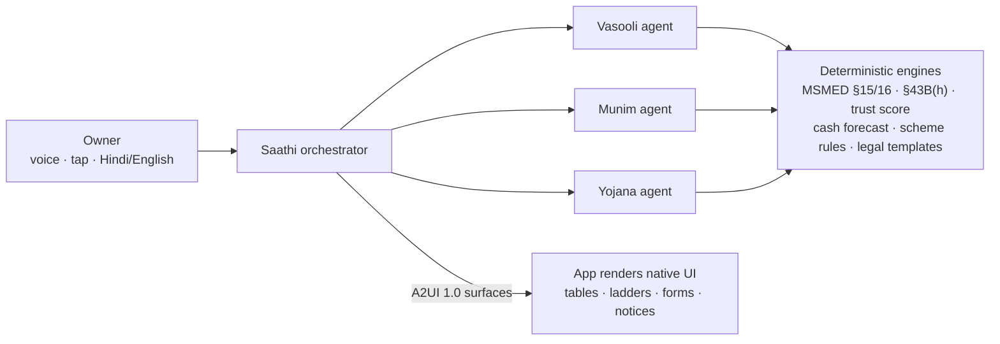

<div align="center">

# उ &nbsp;Udyam Saathi

### Every MSME deserves a munim.

**An agentic AI back-office for India's small businesses.**<br/>
Saathi recovers late payments with the law on your side, keeps your books and forecasts your cash, and finds the government schemes and loans you qualify for. It works in Hindi or English, by voice or by tap.

BUILD 2036 · TiE Global Summit 2026 · **Frontier 06: The Rise of New India**

</div>

---

## The story

Ramesh Patidar makes namkeen in Palda, Indore. Eight people work for him. His sev and mixture sell well, so the problem isn't sales.

Sharma Traders owes Ramesh **₹2,40,000** for an invoice that is now **60 days old**. Malwa Retail owes **₹1,85,000**, and Indore Caterers has gone quiet on **₹38,500**. Ramesh keeps his accounts in a register. He calls, waits, calls again, and on bad weeks borrows to pay wages.

Ramesh doesn't know that **the law is already on his side:**

- **MSMED Act §15:** a buyer must pay a registered micro or small supplier within the agreed credit period, which can never exceed 45 days.
- **§16:** if the buyer pays late, they owe **compound interest at three times the RBI bank rate**.
- **Income Tax §43B(h):** a buyer who pays an MSE late **can't deduct that expense** until the year it's actually paid. 31 March is a deadline they care about.
- **MSME Samadhaan** lets Ramesh file a case online, and **TReDS** can turn an unpaid invoice into cash in days.

None of this helps him on his own. Big companies have finance teams; Ramesh has a register and a phone.

**Udyam Saathi is the finance team Ramesh never had.** He says *"Sharma Traders ने 60 दिन से पैसा नहीं दिया"* ("Sharma Traders hasn't paid me for 60 days"). Saathi works out that the invoice is 30 days past the legal limit, that he can claim **₹3,300 in interest**, and that Sharma loses a tax deduction if it isn't paid by 31 March. It drafts a legally grounded notice in Hindi, and with one tap from Ramesh it goes out on WhatsApp.

Then it does what a good munim does: it **stops the next one**. It sends a friendly reminder before the next invoice falls due, follows up when a notice gets no response, and tells Ramesh which buyers have earned credit and which should pay in advance.

> In one minute, for this one shop, Saathi finds **₹4,71,049** to recover, flags **3 risky buyers**, matches **8 government schemes**, and scores the business **66/100** for loan readiness.
> *(Computed by the app for the demo business. Every number comes from code, not guesswork.)*

---

## What it does

Three specialist agents, coordinated by **Saathi**:

| Agent | Job | Highlights |
|---|---|---|
| ⚖️ **Vasooli** (recovery) | Get stuck money back, and prevent the next case | Due dates and interest under MSMED §15/16 · the §43B(h) deadline as leverage · TReDS cash option · recovery ladder (friendly reminder → polite reminder → legal notice → MSME Samadhaan) · **buyer trust scores A–D** with credit advice |
| 📒 **Munim** (books) | Keep the ledger and see cash coming | Invoices and payments · **6-week cash forecast** adjusted for each buyer's real payment habits · cash-crunch warnings |
| 🏛️ **Yojana** (schemes) | Unlock government support | 12 central and Madhya Pradesh schemes with explicit eligibility rules · document checklists · **loan readiness score** with steps to improve |

And around them:

- **Heads-up alerts:** reminders before due dates, follow-ups after notices, "pause credit" warnings, and a 31 March countdown.
- **Human in the loop:** nothing is sent without the owner tapping *Approve*.
- **Built for owners who don't use much technology:**
  - Hindi first and voice first
  - an 11-step guided tour that **reads every tip aloud in a natural Indian voice**
  - large touch targets and one clear action per card

---

## How it works



- **AI handles the language. Code handles the money.** Interest, dates, eligibility, scores and legal wording come only from deterministic engines and vetted templates. AI never does arithmetic and never writes legal claims.
- **Agents send UI, not paragraphs.** Every reply is a [**Google A2UI 1.0**](https://a2ui.org) generative-UI surface, such as a table, a recovery ladder, a form or a notice awaiting approval. The app draws it with its own components. Agents can only use components from the app's own set, so they can't put anything arbitrary on screen.
- **Trust by design:** every scheme links to its official source; numbers are traceable; there's a "not legal advice" notice throughout; and the owner approves every message.

The full design is in **[docs/ARCHITECTURE.md](docs/ARCHITECTURE.md)**.

---

## Try it

```bash
npm install
npm run dev
# Landing:   http://localhost:3000
# Workspace: http://localhost:3000/app   (the guided tour starts on first visit)
```

No API key is needed. The app ships with a demo business (Shree Ganesh Namkeen, Indore) whose dates are relative to today, so the demo never goes stale.

**A 60-second path through it:**
1. On the landing page, drag the **interest calculator** sliders.
2. Click **Start**, turn on **Read aloud** in the tour, and follow it.
3. On **Today**, tap **Recover** on Sharma Traders, then **Draft legal notice**, then **Approve**.
4. Ask Saathi *"आज क्या करना है?"* ("What should I do today?") or *"Which buyers can I trust?"*
5. Open **Yojana** to see your loan readiness and the schemes you qualify for.

---

## Status

| | |
|---|---|
| ✅ Done | Landing page, guided tour, all three agents, A2UI renderer, alerts, trust scores, cash forecast, loan readiness, Hindi and English, read-aloud in a natural Indian voice, liquid-glass UI, submission docs, demo film |
| 🔜 Next | LLM intent understanding (Gemini) for free-form Hindi/Hinglish, with the keyword router as a fallback · invoice-from-photo · public deployment |
| 🧭 Roadmap | WhatsApp Business API · GST / Account Aggregator imports · TReDS and lender APIs · more languages (Kannada, Gujarati, Tamil) |

Today, requests are routed by keyword rules (`routeText` in `src/agent/agent.ts`). The LLM slot replaces only that step, so every engine and screen stays the same.

---

## Tech

Next.js 16 · React 19 · TypeScript · Tailwind CSS 4 · Motion · A2UI 1.0 (own renderer and catalog) · Web Speech API · Edge neural TTS (en-IN / hi-IN) via `/api/tts` · Gemini (planned)

```
src/
  app/          landing (page.tsx) · workspace (app/page.tsx) · api/agent · api/tts
  a2ui/         protocol.ts (A2UI 1.0 messages, bindings) · Surface.tsx (renderer + catalog)
  agent/        agent.ts (orchestrator + Vasooli/Munim/Yojana) · builder.ts (UI macros)
  lib/          vasooli.ts · insights.ts · schemes.ts · notices.ts · demo-data.ts · types.ts
  components/   App shell · pages/ · Assistant · tour/ · landing/
  ui/           primitives · motion · charts · speech
```

---

## Submission pack

| Document | What's inside |
|---|---|
| [Architecture](docs/ARCHITECTURE.md) | System and sequence diagrams, A2UI, engines, AI slot, roadmap |
| [Impact case](docs/IMPACT.md) | Problem, persona, value, metrics, business model, go-to-market, risks |
| [Demo script](docs/DEMO_SCRIPT.md) | 3-minute video and 5-minute live pitch |
| [Pitch outline](docs/PITCH_OUTLINE.md) | 12-slide deck |
| [Fact-check list](docs/FACT_CHECK.md) | Legal points, rates and statistics to verify before submission |

---

## Team

Created by **Abhishek S** and **Sricharan S** for BUILD 2036, the official hackathon of the TiE Global Summit 2026.

<sub>Udyam Saathi is an independent product and is not affiliated with the Government of India. It does not provide legal or financial advice; confirm with a CA or advocate. Scheme details are pending verification against official sources.</sub>
