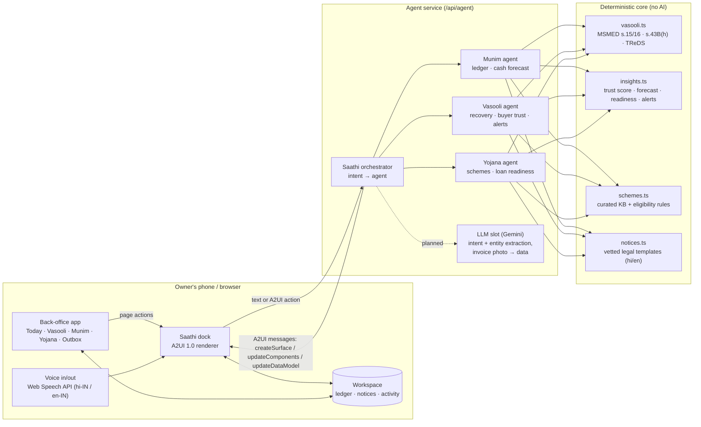
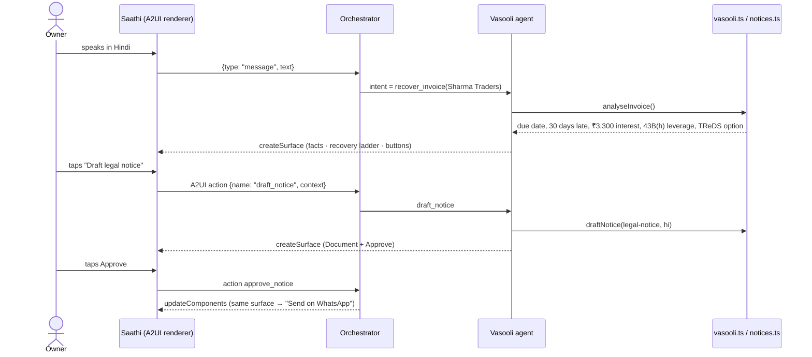

# Udyam Saathi: Architecture

**Udyam Saathi** is an agentic back-office for India's micro and small businesses. Three specialist agents recover late payments, keep the books, and match the business to government schemes and loans. Owners use it in Hindi or English, by voice or by tapping.

## 1. System overview

## 2. Design principles

| Principle | How it is implemented |
|---|---|
| **AI handles language. Code handles money.** | Interest, due dates, eligibility, scores and legal wording come only from deterministic engines and vetted templates. The model never does arithmetic or writes legal claims. |
| **Agents send UI, not paragraphs** | Every reply is an **A2UI 1.0** surface: a table, a recovery ladder, a form, or a document awaiting approval. The app draws it with its own components. |
| **Human in the loop** | No notice is sent without the owner tapping *Approve*. Sending opens WhatsApp or the official MSME Samadhaan portal. |
| **Works offline from AI** | If the model is unavailable, a keyword router takes over, so the live demo cannot fail. |
| **Designed for low digital literacy** | Hindi first, voice input, read-aloud guided tour, large touch targets, and one primary action per card. |

## 3. Agent flow (example: "Sharma Traders ने 60 दिन से पैसा नहीं दिया", "Sharma Traders hasn't paid me for 60 days")

## 4. A2UI 1.0 implementation

- **Agent to renderer:** `createSurface`, `updateComponents`, `updateDataModel`, `deleteSurface`. Every message carries `"version": "1.0"`.
- **Renderer to agent:** the `action` message (`name`, `surfaceId`, `sourceComponentId`, `timestamp`, resolved `context`).
- **Data binding:** `{"@path": "/f/age"}`, including relative paths inside templated lists. `{"@call": "formatCurrency" | "formatString" | …}` is also supported.
- **Catalogs:**
  - The A2UI basic catalog: Text, Row, Column, List, Card, Divider, Button, TextField, CheckBox, ChoicePicker, Tabs, Icon.
  - A custom **Udyam catalog**: Metric, Badge, KeyValue, Table, Steps, Callout, Document.
  - Agents can only place catalog components. Anything else renders as a visible placeholder and is never executed.
- **Code:**
  - `src/a2ui/protocol.ts`: message types, JSON Pointer, binding resolution
  - `src/a2ui/Surface.tsx`: renderer
  - `src/agent/builder.ts`: UI macros

## 5. Deterministic engines

| Engine | Logic | File |
|---|---|---|
| **Delayed payment** | Due date is the agreed credit period capped at 45 days, or 15 days with no written agreement. Interest is compound with monthly rests at 3× the RBI bank rate (s.16). Covers Udyam-registered micro and small manufacturers and service providers only (traders are excluded). Also computes the 43B(h) year-end leverage and indicative TReDS proceeds. | `src/lib/vasooli.ts` |
| **Recovery ladder** | courtesy (before due) → reminder (1–15 days late) → legal notice (16–45) → MSME Samadhaan filing (45+) | `vasooli.ts`, `notices.ts` |
| **Buyer trust score** | Starts at 100, then subtracts: average days late × 1.1, current worst overdue × 0.7, and up to 20 points for the share of late payments. Graded A–D, each with credit advice. | `src/lib/insights.ts` |
| **Cash forecast** | Each unpaid invoice lands on its due date shifted by that buyer's average delay. Invoices from late or risky buyers are flagged "at risk". Shown over 6 weeks. | `insights.ts` |
| **Loan readiness** | Udyam (20) + GST (15) + digital records (15) + on-time collection (25) + low overdue share (25). An estimate from the owner's own records, not a bureau score. | `insights.ts` |
| **Proactive alerts** | Friendly reminder ≤7 days before due · follow-up 7 days after a notice · pause credit to grade-D buyers · 43B(h) window before 31 March | `insights.ts` |
| **Scheme matching** | 12 central and MP schemes, each with explicit eligibility rules, required documents and an official source link | `src/lib/schemes.ts` |

## 6. Where AI plugs in (the next build step)

| Slot | What the model does | What stays deterministic |
|---|---|---|
| Intent and entities | Free-form Hindi, Hinglish or English becomes `{action, buyer, stage, amount…}` through function calling, replacing `routeText()` | Every downstream calculation and screen |
| Invoice photo | A bill image becomes buyer, amount, date and GSTIN, then goes to `create_invoice` | Due-date and interest logic |
| Plain-language summary | A one-line spoken summary of each surface in the owner's language | Legal notice text (templates only) |

The model choice is **Gemini** (free tier: Hindi, function calling, vision). The key lives server-side only. If the model is unavailable, the keyword router serves as the fallback.

## 7. Production roadmap

| Area | Next step |
|---|---|
| Channel | WhatsApp Business API, so the agent works inside WhatsApp itself |
| Data in | GST e-invoice / GSTR-1 import, Account Aggregator (bank statements), UPI collections |
| Money out | TReDS platform APIs for one-tap invoice discounting; lender APIs for loan referrals |
| Storage | Encrypted per-business store (the prototype keeps data in the browser) |
| Trust | Templates reviewed by a lawyer; scheme knowledge base refreshed monthly from official sources |

## 8. Tech stack

Next.js 16 (App Router) · React 19 · TypeScript · Tailwind CSS 4 · Motion · lucide-react · Web Speech API · A2UI 1.0 (own renderer) · Gemini (planned).
